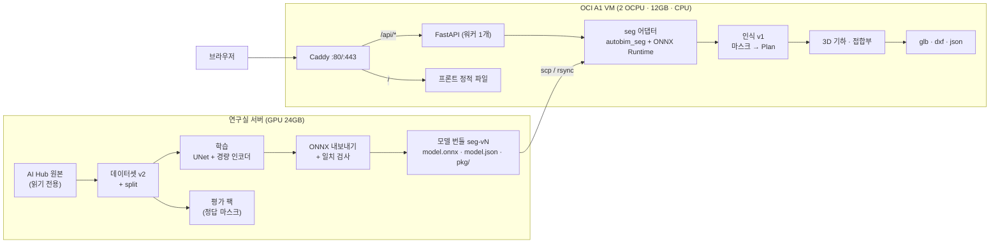
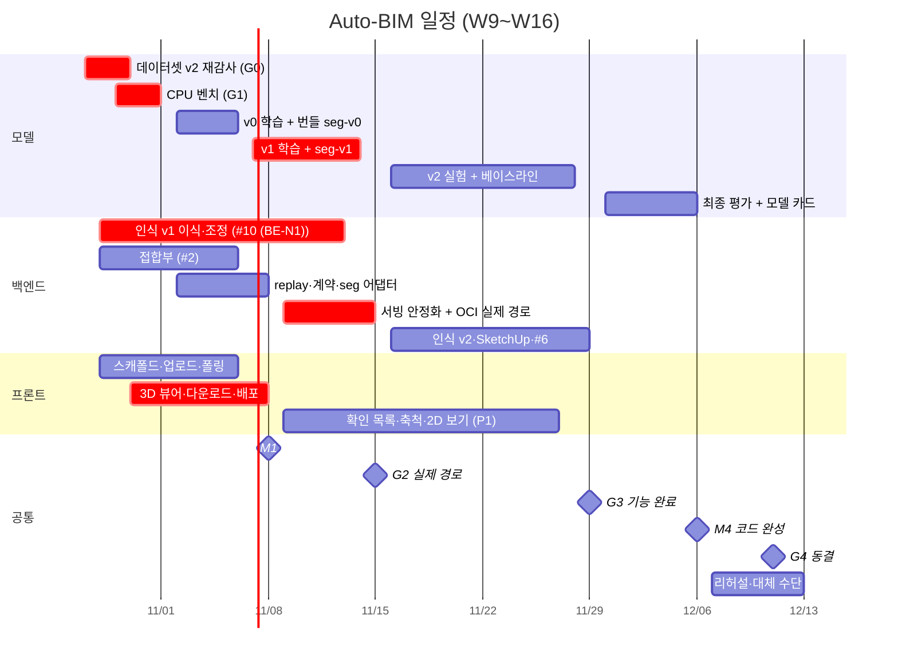
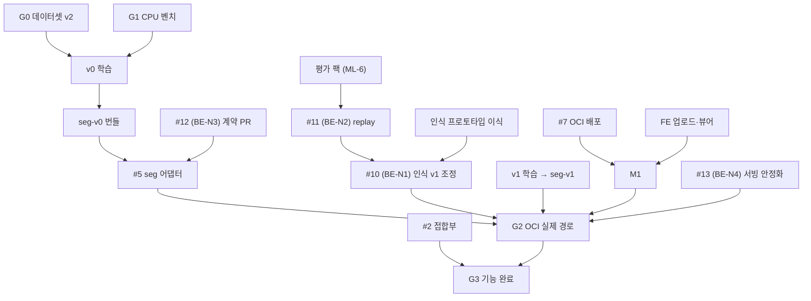

# Auto-BIM 완성 로드맵 (A to Z)

> 기준일 2026-10-27(화, 9주차). 시연은 16주차(12/14~12/20, 날짜 미정)로 잡고, **코드 동결은 12/11(금)**로 한다.
> 이 문서는 "언제, 누가, 무엇을, 어떤 기준으로" 끝내는지 정한다. 각 작업을 *어떻게* 하는지는 링크된 명세를 본다.
> 확정되지 않은 것은 [DECISIONS.md](DECISIONS.md)의 "미결" 항목에 있다. 추측으로 채우지 않았다.

## 0. 한 장 요약

| 항목 | 내용 |
|---|---|
| 끝났을 때 모습 | 공개 URL에 디지털 평면도 이미지를 올리면 약 1분 안에 웹에서 3D가 보이고, `.glb`·`.dxf`·`.json`을 내려받는다. `.dxf`는 벽마다 블록으로 나뉜다 |
| 필수(P0) | 디지털 평면도 이미지 → 3D + `.dxf`. 이것만 되면 시연이 성립한다 |
| 서빙 | OCI Always Free A1 VM 한 대(**2 OCPU, 12 GB, GPU 없음**)에서 백엔드와 추론을 모두 돌린다 |
| 학습 | 연구실 서버 GPU 24 GB 한 장 |
| 가장 위험한 것 | ① 실제 모델 마스크 → Plan 변환(인식 v1) ② CPU 추론 시간 ③ 프론트 일정 |
| 이번 주 끝(11/1)까지 | 데이터셋 재감사 통과(G0), OCI에서 CPU 벤치마크로 모델 구조·배율 결정(G1), 프론트 착수, 인식 v1 이식 착수 |

## 1. 목표와 범위

### 1.1 "완성"의 정의 (시연 합격선)

아래 6개가 모두 되면 프로젝트가 완성된 것이다.

1. 공개 URL(OCI)에서 디지털 평면도 이미지(PNG/JPG, A3 300dpi급)를 올리면 **2분 안에** 웹 3D 뷰어에 벽·문·창이 보인다.
2. `.glb`·`.dxf`·`.json`을 내려받을 수 있다. `.dxf`는 mm 단위이고 벽마다 블록(`WALL_<id>`)으로 나뉘며, 팀이 정한 SketchUp 버전에서 열린다.
3. 미리 고른 데모 도면 세트에서 주요 벽과 문·창이 눈으로 봐서 맞다. 정량 지표는 [EVALUATION_PLAN.md](EVALUATION_PLAN.md)를 따른다.
4. 축척이 추정값이면 화면에 표시되고, 사용자가 건물 가로 길이를 넣으면 모델을 다시 돌리지 않고 다시 만든다(P1).
5. 모델 지표(APT100)와 시스템 지표(Plan 단위) 표가 있다.
6. 대체 수단이 준비돼 있다: 미리 만든 결과, 녹화 영상, 노트북에서 같은 이미지 실행. 상세: [DEMO_PLAN.md](DEMO_PLAN.md)

### 1.2 우선순위

| 등급 | 뜻 | 항목 |
|---|---|---|
| **P0** | 없으면 시연 불가 | 인식 모델(4클래스 분할) · `autobim_seg` · 백엔드 `seg` 어댑터 · **인식 v1**(마스크 → Plan) · 접합부 처리(#2) · 업로드 제한(#12 (BE-N3)) · 서빙 안정화(추론 동시 실행 1개, #13 (BE-N4)) · OCI 배포(#7) · 프론트 업로드 → 진행 상태 → 3D 뷰어 → 다운로드 |
| **P1** | 있으면 시연·보고서 품질이 크게 오름 | 축척 입력(건물 가로 길이) · 확인 필요 목록 · 2D 평면 보기 · Plan 단위 시스템 평가(#6) · SketchUp 호환 확인 · CubiCasa 베이스라인 비교 · 대체 데모 페이지(조건부) |
| **P2** | G3(11/29)에서 여유가 있을 때만 하나 고른다 | 치수 OCR 축척 · DXF 입력(#3) · 법규 검토 · 사진 도면 전처리 · 2D 겹쳐 보기 편집 · 작업 영속화(#4) |

P2는 G3에서 **많아야 하나**만 고른다. P0가 하나라도 빨간불이면 P2는 하지 않는다.

## 2. 현재 상태 (2026-10-27)

| 영역 | 상태 | 근거 |
|---|---|---|
| 백엔드 뼈대 | ✅ Plan·Jobs API 계약, Fake 모델로 업로드 → Plan → glb/dxf/json 끝까지 동작. 테스트 63개(pytest 기준), CI(lint·test·OpenAPI·docker) | `develop` @ 05cdf86 (PR #1) |
| 백엔드 이슈 | #2~#7, #10~#15 (BE-N1~N6) 열림(담당자 없음). 라벨·마일스톤 M1~v1.0 지정(10/28). PR #8(#5·#6 문서 정렬)·#9(프로젝트 문서 묶음) 머지됨 | GitHub |
| 백엔드 인식(마스크 → 벽) | ⚠️ 축에 평행하고 끊김 없는 Fake 마스크만 처리. 실제 모델 마스크(개구부 끊김, 잡음)는 처리 못 함 | `app/recognition/walls.py` |
| 인식 v1 프로토타입 | ✅ 이번에 작성·검증. 합성 도면 18개 테스트 통과, Fake 도면 결과 재현, A3 크기 마스크 약 2초(x86) | [recognition.md](../recognition.md), `docs/recognition-prototype/` |
| 데이터셋 | ✅ v2 재감사 **조건부 진행 가능**(10/28). 1px 밀림·평가 누수 해소. train 7,257 / tune 806 / APT100 100 → **G0 통과** | `reports/dataset_audit_v2/` |
| 모델 학습 | ⏳ 아직 없음 | |
| 추론 패키지 `autobim_seg` | ⏳ 계약만 있음 | 모델 레포 `docs/MODEL_SPEC.md` |
| CPU 벤치마크 | ✅ 스크립트 작성·검증(x86 2 vCPU 참고값 확보). **A1 실측은 아직** | `autobim-model/scripts/bench_cpu.py` |
| OCI | ⏳ 계정·인스턴스 상태 확인 필요 | 미결 O-03 |
| 프론트 | ⏳ 레포만 있음(커밋 없음) | `Auto-BIM/autobim-fe` |

## 3. 전체 그림

레포별 책임과 접점:

| 레포 | 책임 | 내보내는 것 |
|---|---|---|
| `autobim-model` (연구실 서버) | 데이터, 학습, 모델 평가, 추론 패키지 | **모델 번들**(`seg-vN/`), 평가 팩 |
| `autobim-be` (GitHub) | 인식(마스크 → Plan), Plan, 3D·dxf, API, 배포 | Jobs API(`docs/openapi.json`) |
| `autobim-fe` (GitHub) | 업로드, 진행 표시, 3D 뷰어, 확인·보충 화면 | 정적 웹 파일(`dist/`) |

두 레포가 만나는 계약은 [SYSTEM_SPEC.md](SYSTEM_SPEC.md) §3에 모여 있다.

## 4. 게이트와 마일스톤

게이트(G)는 "통과 못 하면 다음 단계로 못 가는" 판정이다. 마일스톤(M)은 눈에 보이는 결과다.

| 날짜 | 이름 | 통과 기준 | 판정 | 실패하면 |
|---|---|---|---|---|
| 10/30 (금) | **G0 데이터** | 데이터셋 v2 독립 감사 판정 "학습 가능", split 해시 기록 | 항민 | 학습 금지. 수정 → 재감사 |
| 11/1 (일) | **G1 CPU 벤치** | A1에서 `bench_cpu.py pipeline` 실측. A3 한 장 추론 **목표 30초, 상한 60초**를 만족하는 (구조, 배율) 결정 → DECISIONS 기록 | 항민 | 배율 낮춤 → 가벼운 decoder → INT8 순서(모델 레포 `docs/MODEL_SPEC.md` §12) |
| 11/8 (일) | **M1 끝까지 한 번** | ① 공개 URL에서 Fake 도면 업로드 → 3D 보임 → 파일 다운로드 ② 연구실 서버에서 seg-v0 번들 → 백엔드 → glb 끝까지 | 전원 | 프론트가 늦으면 대체 데모 페이지(#15 (BE-N6)) 착수 |
| 11/15 (일) | **G2 / M2 실제 경로** | OCI에서 seg-v1로 tune 도면 5장 모두 `succeeded`, 작업 1건 전체 **90초 이하**, 뷰어에서 열림 | 항민 | 노트북·연구실 서버 대체 경로 준비 시작([RISKS](RISKS.md) R1·R3) |
| 11/29 (일) | **G3 / M3 기능 완료** | P0+P1 체크리스트 완료, 시스템 지표 첫 결과, 데모 후보 10장 중 8장 이상 육안 합격 | 전원 | P1 일부 포기, P2 없음 |
| 12/6 (일) | **M4 코드 완성** | 최종 평가 수치 확정, 데모 세트 결과 미리 생성, 알려진 치명 버그 0 | 전원 | 동결일까지 버그만 |
| 12/11 (금) | **G4 동결** | `release/1.0` → `main`, 태그 `v1.0.0`, OCI 배포본 = 태그, 부트 볼륨 백업 | 항민 | — |
| 16주차 | **시연** | [DEMO_PLAN.md](DEMO_PLAN.md) | 전원 | 대체 수단 |

## 5. 주차별 계획

담당은 [DECISIONS.md](DECISIONS.md) P-01의 **제안**이다. 킥오프에서 확정한다. 작업 키는 아래와 같다.

- `#2`~`#7`, `#10`~`#15`: 백엔드 이슈([next-tasks.md](../next-tasks.md)). 괄호 안의 `BE-N1`~`BE-N6`은 #10~#15를 만들기 전에 쓰던 키다
- `ML-0`~`ML-10`: 모델 레포 작업(모델 레포 `docs/backlog.md`. 모델 레포는 연구실 서버에 있다)
- `FE-1`~`FE-14`: 프론트 이슈([autobim-fe `docs/backlog.md`](https://github.com/Auto-BIM/autobim-fe/blob/develop/docs/backlog.md))

### W9 (10/26~11/1) — 정리하고 착수한다 · G0, G1

| 담당 | 할 일 | 끝난 기준 |
|---|---|---|
| 전원 | 킥오프 회의(§8 안건) | 역할·미결 항목 답이 DECISIONS에 기록됨 |
| 항민 | PR #8 머지 → 이 문서 묶음 PR 머지 → 이슈·라벨·마일스톤 생성 | GitHub에 #10~#15 (BE-N1~N6), 마일스톤 M1~M4 |
| 항민 | ML-0 데이터셋 v2 수정·재감사 | **G0** |
| 항민 | OCI A1 생성, Docker 설치([deploy-oci.md](../deploy-oci.md) §2~4) / ML-1 벤치(연구실 export → OCI run) | **G1** 결정 기록 |
| 항민 | ML-2 학습 스크립트 | 배치 하나 과적합 통과 |
| 조예준 | #10 (BE-N1) 인식 v1: 프로토타입 이식 + 합성 테스트 | 기존 테스트 + 새 합성 테스트 green |
| 조예준 | #2 접합부(별도 worktree) | L·T자 테스트 일부 |
| 강민재 | FE-1 스캐폴드, FE-2 API 타입·클라이언트, FE-3 업로드 | 로컬 Fake 백엔드에 업로드 → 작업 ID 받음 |
| 임준형 | FE-5 3D 뷰어: Fake `model.glb` 띄우기 | 회전·확대 가능한 3D |

### W10 (11/2~11/8) — 끝까지 한 번 연결한다 · M1

| 담당 | 할 일 | 끝난 기준 |
|---|---|---|
| 항민 | ML-3 v0 학습(약 8k iter) → ML-5 ONNX·번들 seg-v0, ML-4 `autobim_seg` v0.1 | 번들 계약 테스트 통과 |
| 항민 | ML-6 평가 팩(dev, tune 30장) | 조예준이 replay로 열 수 있음(데이터 접근은 미결 O-05) |
| 항민 | #12 (BE-N3) 계약 PR(413, 새 오류 코드, `/health` 모델 정보) → #5 seg 어댑터 | CI green, 머지 |
| 항민 | #7 OCI에 Fake 스택 배포(Caddy + api + 프론트) | 공개 URL 동작 |
| 조예준 | #11 (BE-N2) replay 어댑터 → #10 (BE-N1) 실제 정답 마스크로 조정 + 디버그 오버레이 | dev 팩 30장 중 대부분 `succeeded` |
| 조예준 | #2 마무리 | #2 완료 조건 전부 |
| 강민재 | FE-4 폴링·상태, FE-6 다운로드, FE-7 오류 표시, FE-8 OCI 배포 빌드 | 공개 URL에서 동작 |
| 임준형 | FE-5 마무리(카메라 맞춤, 벽 클릭 정보), FE-12 | 벽 ID·두께 표시 |
| 전원 | **M1 확인**(11/8 일) | §4 표 |

### W11 (11/9~11/15) — 실제 경로를 연다 · G2

| 담당 | 할 일 | 끝난 기준 |
|---|---|---|
| 항민 | ML-7 v1 학습(약 40k iter) → seg-v1 → OCI 배포, 시간 측정 | **G2** |
| 조예준 | #13 (BE-N4) 서빙 안정화(추론 동시 1개, EXIF 회전, 오래된 작업 정리, 단계별 시간 로그) | 완료 조건 테스트 |
| 조예준 | #10 (BE-N1) 개선(seg-v0/v1 예측 마스크 실패 사례) | 실패 사례 목록과 수정 |
| 강민재 | FE-9 확인 필요 목록(P1) 착수, 처리 중 화면 다듬기 | |
| 임준형 | FE-11 2D 평면 보기(SVG) 착수, #6 설계 읽기 | |

### W12 (11/16~11/22) — 품질을 올린다

| 담당 | 할 일 |
|---|---|
| 항민 | ML-9 v2 실험(배율·증강·학습량), ML-8 CubiCasa 베이스라인 |
| 조예준 | 인식 v2(실패 유형별 수정), #14 (BE-N5) SketchUp 호환 확인 |
| 강민재 | FE-10 축척 입력, FE-9 마무리 |
| 임준형 | #6 Plan 단위 평가 구현(dev 팩), FE-11 마무리 |

### W13 (11/23~11/29) — 기능을 닫는다 · G3

| 담당 | 할 일 |
|---|---|
| 항민 | seg-v2 확정(tune 지표가 v1보다 좋을 때만 교체), ML-10 모델 카드 초안 |
| 조예준 | 버그 수정, 인식 개선, G3에서 P2를 고르면 설계 |
| 강민재 | FE-14 데모 모드(미리 만든 결과 열기), 화면 다듬기 |
| 임준형 | #6 결과 표, 시간 측정 스크립트 |
| 전원 | **G3 판정**(11/29 일): P0+P1 체크, P2 하나 고를지 결정 |

### W14 (11/30~12/6) — 평가하고 데모를 준비한다 · M4

| 담당 | 할 일 |
|---|---|
| 항민 | 최종 평가 1회(APT100·unseen·보조), 모델 카드 완성 |
| 조예준 | (G3에서 골랐다면) P2 하나, 버그 수정 |
| 강민재 | 데모 세트 결과 미리 생성·저장, 프론트 버그 |
| 임준형 | #6 최종 실행(APT100 팩), OCI 시간 측정(p50/p90) |
| 전원 | 데모 도면 세트 확정, 발표자료 초안 |

### W15 (12/7~12/13) — 동결과 리허설

| 날짜 | 할 일 |
|---|---|
| 12/8 (화) | 리허설 1(전체 흐름, 시간 재기), 실패 지점 목록 |
| 12/10 (목) | 녹화 영상 제작, 노트북 로컬 실행 확인 |
| 12/11 (금) | **G4 동결**: `release/1.0` → `main`, 태그, OCI 배포, 부트 볼륨 백업 / 리허설 2 |
| 12/12~13 | 발표자료·보고서 마무리(과목 요구 산출물은 미결 O-02) |

### W16 (12/14~12/20) — 시연

시연 전날·당일 체크리스트는 [DEMO_PLAN.md](DEMO_PLAN.md) §4.

## 6. 의존 관계 (크리티컬 패스)

크리티컬 패스(늦으면 시연이 밀리는 경로): **G0 → v0 → seg 번들 → seg 어댑터 → G2**, **프로토타입 → 인식 v1 → G2**, **OCI + 프론트 → M1**.
병렬로 돌 수 있는 것: #2, FE 전체, #11 (BE-N2)·#12 (BE-N3)·#13 (BE-N4), 평가(#6)는 서로 막지 않는다.

## 7. 역할 (제안)

| 사람 | 주 담당 | 보조 |
|---|---|---|
| 조항민 | 모델 전부(ML-*), `autobim_seg`, #5 어댑터, #12 (BE-N3) 계약, #7 OCI, #15 (BE-N6)(조건부), 일정 관리 | 코드 리뷰(백엔드) |
| 조예준 | #10 (BE-N1) 인식 v1·v2, #2 접합부, #11 (BE-N2) replay, #13 (BE-N4) 서빙 안정화, #14 (BE-N5) SketchUp | P2 DXF 입력(#3) |
| 강민재 | 프론트 리드: FE-1~4, 6~10, 14 | 프론트 배포(FE-8) |
| 임준형 | FE-5·11·12 뷰어와 2D 보기, #6 시스템 평가, 시간 측정 | CubiCasa 베이스라인 보조 |

근거: 항민은 모델·서버 경험, 임준형은 CV·PyTorch 경험이 있어 #6(평가)이 맞고, 프론트 P0는 두 명이 1.5주면 된다. 확정은 킥오프에서 한다.

## 8. 킥오프 안건 (이번 주, 30~60분)

1. 이 로드맵의 범위·일정·게이트에 동의하는가 (P0/P1/P2, 동결 12/11)
2. 역할 확정 (§7)
3. 미결 항목 답하기: O-01 시연 날짜·형식, O-02 과목 최종 산출물, O-05 데이터 접근, O-07 데모 도면 출처, O-08 SketchUp 버전, O-13 소통 채널·회의 시간
4. 주간 리듬 확정([TEAM_PROCESS.md](TEAM_PROCESS.md) §2)
5. 각자 개발 환경 세팅 날짜 정하기

## 9. 늦어질 때 무엇을 버리나

| 신호 | 판단 시점 | 버리는 것 / 바꾸는 것 |
|---|---|---|
| G0 실패가 11/3까지 이어짐 | 11/3 | 감사 통과한 부분집합(예: 아파트만)으로 v0 학습 |
| A1 추론이 상한 60초를 넘음 | G1 | 배율 0.5 → 0.4, 가벼운 decoder, INT8. 그래도 넘으면 연구실 서버를 추론 서버로(O-03, R1) |
| M1에서 프론트 3D가 안 뜸 | 11/8 | #15 (BE-N6) 대체 데모 페이지(백엔드가 정적 HTML 하나를 `/fallback/`에 제공) |
| G2에서 실제 도면 성공률이 낮음 | 11/15 | 데모 도면을 잘 되는 유형으로 좁힘, 확인·보충(P1)으로 사용자가 고치는 흐름을 시연 |
| G3에서 P0/P1 미완 | 11/29 | P2 전부 포기, P1 중 2D 보기·베이스라인부터 버림 |
| 동결 후 치명 버그 | 12/11~ | `hotfix/*`만, 기능 추가 금지 |

## 10. 문서 지도

| 문서 | 무엇 |
|---|---|
| [SYSTEM_SPEC.md](SYSTEM_SPEC.md) | 전체 시스템 명세: 처리 단계, 레포 간 계약, 시간·메모리 예산, 설정 |
| [../recognition.md](../recognition.md) | 인식 v1 알고리즘(마스크 → 벽·개구부 → Plan) |
| [../deploy-oci.md](../deploy-oci.md) | OCI 배포 런북 |
| [../next-tasks.md](../next-tasks.md) | 백엔드 이슈 범위·완료 조건 |
| [EVALUATION_PLAN.md](EVALUATION_PLAN.md) | 무엇을 어떻게 재서 보고하나 |
| [DEMO_PLAN.md](DEMO_PLAN.md) | 시연 시나리오·대체 수단·체크리스트 |
| [DECISIONS.md](DECISIONS.md) | 확정·제안·미결 결정 |
| [RISKS.md](RISKS.md) | 위험과 대응 |
| [TEAM_PROCESS.md](TEAM_PROCESS.md) | 일하는 방식, Git·PR·에이전트 사용 규칙 |
| [PROMPTS.md](PROMPTS.md) | 작업별 Claude Code / Codex 프롬프트 |
| `autobim-model/docs/MODEL_SPEC.md` (연구실 서버) | 모델·학습·추론 패키지·번들 명세 |
| [`autobim-fe/docs/FRONTEND_SPEC.md`](https://github.com/Auto-BIM/autobim-fe/blob/develop/docs/FRONTEND_SPEC.md) | 프론트 명세 |
