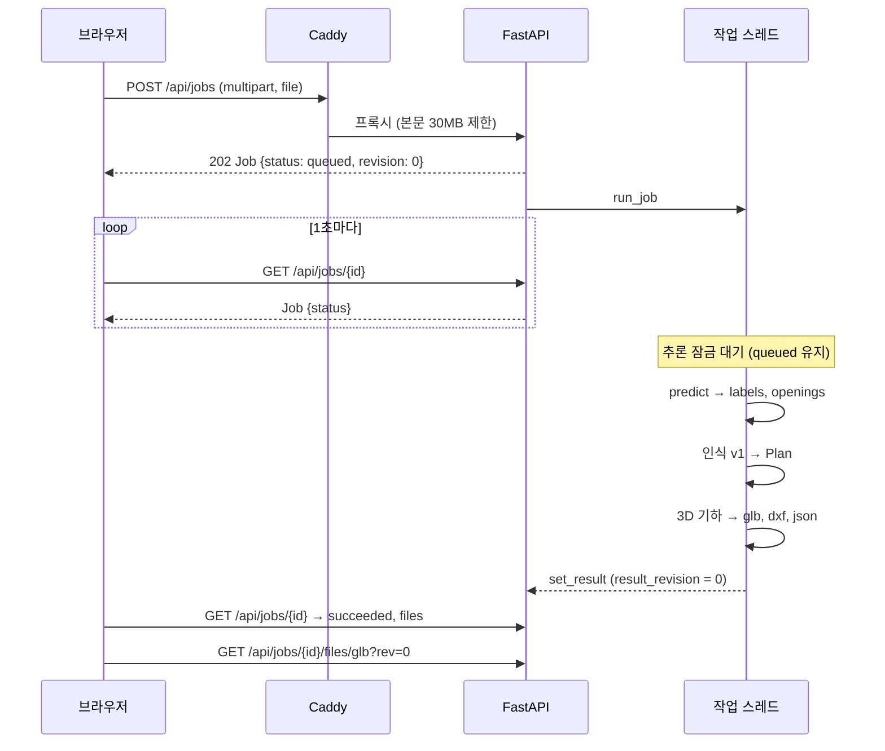

# Auto-BIM 시스템 명세

> 세 레포(`autobim-model`, `autobim-be`, `autobim-fe`)가 어떻게 하나의 서비스가 되는지 정한다.
> API 형식의 원본은 [../api.md](../api.md)와 [../openapi.json](../openapi.json), 좌표 규약의 원본은 [../design.md](../design.md) §2다. 이 문서는 그것들을 바꾸지 않고 **연결**한다.
> "계획"이라고 적은 항목은 아직 코드에 없다. 담당 이슈를 같이 적었다.

## 1. 구성 요소와 배치

| 구성 요소 | 위치 | 기술 | 프로세스 |
|---|---|---|---|
| 프론트 | OCI VM, Caddy가 정적 파일로 제공 | React + TypeScript + three.js ([FRONTEND_SPEC](https://github.com/Auto-BIM/autobim-fe/blob/develop/docs/FRONTEND_SPEC.md)) | 없음(정적) |
| 리버스 프록시 | OCI VM, 컨테이너 `web` | Caddy 2 | `/api/*`·`/health` → `api:8000`, 나머지 → 프론트 |
| 백엔드 API | OCI VM, 컨테이너 `api` | FastAPI + uvicorn, Python 3.11 | **uvicorn 워커 1개**(§9) |
| 작업 실행 | `api` 프로세스 안의 스레드 | FastAPI `BackgroundTasks` | 추론 구간은 한 번에 하나(계획, #13 (BE-N4)) |
| 추론 | `api` 프로세스 안 | `autobim_seg` + ONNX Runtime(CPU, aarch64) | 스레드 2개 |
| 모델 번들 | OCI VM `/opt/autobim/models/seg-vN/` → 컨테이너 `/models`(읽기 전용) | `model.onnx` + `model.json` + `pkg/autobim_seg/` | — |
| 학습·평가 | 연구실 서버(GPU 24 GB) | PyTorch, segmentation-models-pytorch | — |

OCI VM 사양: Always Free A1, **2 OCPU, 12 GB**(공식 문서: "equivalent to 2 OCPUs and 12 GB of memory", [Always Free Resources](https://docs.oracle.com/en-us/iaas/Content/FreeTier/resourceref.htm)). GPU는 없다. 같은 출처(Caddy 하나)로 프론트와 API를 같이 내보내므로 **CORS 설정이 필요 없다**(제안 P-05).

## 2. 요청 한 건의 흐름



단계별 시간(A3 300dpi 한 장, A1 2 OCPU). x86 2 vCPU 실측값에 A1 예상 배수(약 3배, §5)를 곱한 **추정**이다. G1·G2에서 실측으로 바꾼다.

| 단계 | 코드 | x86 2 vCPU 실측 | A1 추정 |
|---|---|---|---|
| 업로드·디코딩 | `app/api/jobs.py`, `app/preprocess/image.py` | < 1초 | 1초 |
| predict (UNet-R18, 배율 0.5, 타일 6개) | `autobim_seg` | 5.5초 | 15~20초 |
| 인식 v1 (A3 크기 마스크) | `app/recognition/` | 1.9초 | 4~6초 |
| 3D 기하·파일 쓰기 | `app/geometry/`, `app/export/` | < 1초 | 1~2초 |
| **합계** | | 약 8초 | **약 20~30초** |

## 3. 레포 간 계약

### 3.1 모델 번들 (모델 레포 → 백엔드)

모델 레포가 버전마다 폴더 하나를 만든다. 백엔드는 이 폴더 경로 하나만 안다(`AUTOBIM_SEG_BUNDLE`).

```
/opt/autobim/models/
├── seg-v1/
│   ├── model.onnx          # 입력 (1, 1, T, T) float32, 출력 (1, 4, T, T) logits
│   ├── model.json          # 아래 필드
│   ├── MODEL_CARD.md       # 지표, 입력 조건, 실패 유형
│   ├── SHA256SUMS          # `sha256sum -c SHA256SUMS`로 복사 후 검사
│   └── pkg/
│       └── autobim_seg/    # 이 번들과 짝인 추론 패키지 (순수 파이썬)
└── current -> seg-v1       # 상대 심볼릭 링크. 교체·롤백은 링크만 바꾼다
```

`model.json` (필수 필드):

| 필드 | 예 | 뜻 |
|---|---|---|
| `name` | `"seg-v1"` | 번들 이름(폴더 이름과 같다) |
| `autobim_seg_version` | `"0.2.0"` | `pkg/autobim_seg.__version__`과 같아야 한다 |
| `arch` | `"unet_r18"` | G1에서 정한 구조 |
| `onnx.file`, `onnx.sha256`, `onnx.opset`, `onnx.input_shape` | `"model.onnx"`, `"…"`, `18`, `[1,1,1024,1024]` | 로드할 때 sha256을 검사한다 |
| `preprocess.grayscale`, `preprocess.mean`, `preprocess.std` | `true`, `0.449`, `0.226` | 학습과 같은 값 |
| `preprocess.scale` | `0.5` | 추론 배율(입력을 이만큼 줄여서 추론) |
| `tiling.tile`, `tiling.overlap`, `tiling.skip_blank_min` | `1024`, `256`, `250` | 타일, 겹침, 빈 타일 판정(회색값 최솟값 ≥ 이 값이면 건너뜀) |
| `classes` | `["background","wall","door","window"]` | 순서 고정 |
| `train.dataset_version`, `train.split_sha256`, `train.git_commit`, `train.config`, `train.iters` | | 재현 정보 |

번들을 바꾸는 절차와 검사 목록은 모델 레포 `docs/MODEL_SPEC.md` §10, OCI 쪽 작업은 [../deploy-oci.md](../deploy-oci.md) §7.

### 3.2 `autobim_seg` API (모델 레포가 지킨다)

```python
import autobim_seg

seg = autobim_seg.load("/models/current", runtime="onnx", threads=2)   # sha256 검사 포함
r = seg.predict(image)   # image: (H, W, 3) uint8 RGB, 크기 제한 없음
r.labels                 # (H, W) uint8, 값 0~3. 입력과 같은 크기. 255 없음
r.scale                  # 추론 배율 (예: 0.5)
r.probs                  # (h, w, 4) float16 또는 None. h, w는 "배율 적용 후" 크기
r.openings()             # [("door"|"window", (x0, y0, x1, y1), conf), ...]  입력 픽셀 좌표
r.mean_confidence(1)     # 벽으로 예측된 픽셀의 평균 확률 (probs가 없으면 1.0)
seg.info                 # model.json 내용 (dict)
autobim_seg.openings_from_labels(labels, probs=None, scale=1.0)   # 평가·replay도 이 함수를 쓴다
```

규칙: 좌표는 입력 이미지 픽셀(원점 좌상단, y 아래). 그레이스케일 변환·정규화·배율·타일링·빈 타일 건너뛰기는 모두 `predict` 안에서 한다. 서빙 경로(`runtime="onnx"`)는 torch를 import하지 않는다.

### 3.3 백엔드 모델 인터페이스와 `seg` 어댑터

계약 [`app/models/base.py`](../../app/models/base.py)는 그대로 두고, 어댑터가 `autobim_seg` 결과를 변환한다(이슈 #5).

| 백엔드 인터페이스 | 만드는 법 |
|---|---|
| `WallSegmenter.segment(image)` → `WallMask` | `mask = (r.labels == 1)`, `confidence = r.mean_confidence(1)` |
| `OpeningDetector.detect(image)` → `list[OpeningDetection]` | `r.openings()`의 각 항목 → `OpeningDetection(OpeningType(t), BBox(x0, y0, x1, y1), conf)` |
| `DimensionReader.read(image)` | `none`(P0). 치수 OCR은 P2 |

- `image_to_plan`은 같은 `image` 객체로 `segment`와 `detect`를 차례로 부른다. 어댑터는 **마지막 이미지 객체를 기억하고 `is`로 비교**해 `predict`를 한 번만 돌린다.
- `wall_segmenter`와 `opening_detector`가 둘 다 `seg`이면 레지스트리는 **어댑터 인스턴스 하나를 공유**한다(모델을 두 번 올리지 않는다).
- 설정: `models.seg.bundle_dir`(환경변수 `AUTOBIM_SEG_BUNDLE`), `models.seg.threads`(`AUTOBIM_SEG_THREADS`, 기본 2).
- 번들이 없거나 sha256이 다르면 **앱 시작 시 실패**한다(작업마다 실패하지 않게).
- 개발·평가용 `replay` 어댑터(#11 (BE-N2))는 평가 팩에 저장된 정답·예측 마스크를 같은 인터페이스로 돌려준다. 조회 키는 디코딩한 RGB 배열의 sha1이다.

### 3.4 Plan과 좌표

| 공간 | 원점·축 | 단위 |
|---|---|---|
| 이미지 | 좌상단, x 오른쪽, **y 아래** | px |
| Plan | 이미지 좌하단, x 오른쪽, **y 위** | mm |
| glTF(.glb) | x 오른쪽, **Y 위(높이)**, z 화면 쪽 | m |
| DXF | Plan 그대로, 높이는 Z | mm (`$INSUNITS = 4`) |

변환식(`s` = `scale.mm_per_px`, `H` = 이미지 높이 px):

```
Plan:  x_mm = x_px · s          y_mm = (H − y_px) · s
역:    x_px = x_mm / s          y_px = H − y_mm / s
glTF:  (X, Y, Z) = (x_mm, z_mm, −y_mm) / 1000      # z_mm = 바닥에서의 높이
```

**계산 예** (스크립트로 검증한 값). 이미지 4963 × 3509 px, 치수 없음, 외벽 두께 24 px로 측정:

| 항목 | 값 |
|---|---|
| 축척 | `s = 200 / 24 = 8.333 mm/px` (`assumed_wall_thickness`, `estimated = true`, 확인 필요 항목 `scale_estimated`) |
| 벽 중심선 (1000, 1000) px → (2800, 1000) px | 시작 (8333.3, 20908.3) mm, 끝 (23333.3, 20908.3) mm, 길이 15000 mm, 두께 200 mm |
| 그 벽의 문: 벽 방향 구간 1500~1608 px | `position = ((1500 + 1608)/2 − 1000) · s = 4616.7 mm`, `width = 108 · s = 900 mm` |
| glTF에서 벽 시작점(바닥) | (8.333, 0, −20.908) m |
| 사용자가 건물 가로 길이 14000 mm 입력 (지금 가로 15000 mm) | 비율 0.9333, 새 `mm_per_px = 7.778`, 좌표·두께·개구부 위치·폭에 0.9333을 곱함. 높이는 그대로 |

### 3.5 Jobs API (프론트가 쓰는 방법)

원본은 [../api.md](../api.md). 프론트 쪽 흐름만 요약한다.

1. `POST /api/jobs`(필드 `file`) → 202 `Job`. `job.id`를 URL(`/jobs/:id`)에 넣는다.
2. `status`가 `queued`·`running`이면 1초마다 `GET /api/jobs/{id}`.
3. `succeeded`이면 `job.files.glb`를 `?rev=${job.result_revision}`를 붙여 불러온다(캐시 무효화).
4. 보충 입력: `POST /api/jobs/{id}/supplement` → 202 `Job`(`revision + 1`, `queued`). 다시 2번. 그동안 `plan`·`files`는 **이전 성공 리비전 것**이 그대로 있다(`result_revision < revision`).
5. `failed`이면 `job.error.code`로 메시지를 고른다. HTTP 오류는 `{"detail": {"code", "message"}}`.

## 4. 처리 단계 명세

| 단계 | 입력 | 출력 | 코드 | 담당 이슈 |
|---|---|---|---|---|
| S1 업로드 검사 | multipart `file` | 원본 파일, `JobInput` | `app/api/jobs.py` | 크기·픽셀 제한 #12 (BE-N3) |
| S2 디코딩 | bytes | (H, W, 3) uint8 RGB. JPEG EXIF 회전 적용(계획) | `app/preprocess/image.py` | #13 (BE-N4) |
| S3 분할 | RGB | `labels` (H, W) uint8, `openings` | `autobim_seg` (모델 레포) | ML-4 |
| S4 어댑터 | `SegResult` | `WallMask`, `list[OpeningDetection]` | `app/models/seg.py`(계획) | #5 |
| S5 인식 v1 | 벽 마스크, 개구부 박스 | 축 정렬 벽(px), 개구부 구간(px), 외벽/내벽 | `app/recognition/` | #10 (BE-N1) |
| S6 축척 | 외벽 두께(px) 또는 치수 | `Scale` | `app/recognition/pipeline.py` | 있음 |
| S7 Plan | S5 + S6 | `Plan`(mm) + 확인 필요 항목 | `app/recognition/pipeline.py` | 있음 + #10 (BE-N1) |
| S8 보충 입력 재적용 | 기준 Plan + 보충 입력들 | Plan | `app/jobs/supplement.py` | 있음 |
| S9 3D 기하 | Plan | 벽별 메시(mm) | `app/geometry/` | #2 접합부 |
| S10 파일 | Plan, 메시 | `plan.json`, `model.glb`, `model.dxf` | `app/export/` | 있음 |

인식 v1의 세부 알고리즘·파라미터·테스트는 [../recognition.md](../recognition.md).

## 5. 성능·자원 예산

### 5.1 CPU 추론 벤치마크 (x86 참고값)

`autobim-model/scripts/bench_cpu.py`로 2026-10-27에 이 문서를 쓰면서 잰 값이다. **기계가 다르다**: x86 Xeon 2 vCPU(AVX-512), onnxruntime 1.31.1, 스레드 2, 가중치는 무작위(속도는 가중치 값과 무관), 입력 1채널 1024 × 1024 타일.

| 후보 | 파라미터 | GFLOPs/타일 | ms/타일 | A3 배율 1.0 (타일 35) | 배율 0.5 (타일 6) | 배율 0.35 (타일 4) |
|---|---|---|---|---|---|---|
| `unet_r18` | 14.3M | 170 | 751 | 26.3초 | 4.5초 | 3.0초 |
| `unet_r18_lite` (decoder 128-64-32-16-16) | 12.5M | 112 | 540 | 18.9초 | 3.2초 | 2.2초 |
| `unet_r34` | 24.4M | 248 | 1298 | 45.4초 | 7.8초 | 5.2초 |
| `unet_mnv2` | 6.6M | 108 | 681 | 23.8초 | 4.1초 | 2.7초 |
| `unet_effb0` | 6.3M | 95 | 656 | 22.9초 | 3.9초 | 2.6초 |
| `segformer_b0` | 3.7M | 87 | 1073 | 37.6초 | 6.4초 | 4.3초 |

전체 흐름(`pipeline`: 배율 → 타일 → 겹침 합성 → 원래 크기 labels) 실측: `unet_r18` 배율 0.5 **5.5초**, 최대 메모리 약 1.1 GB / 배율 1.0 **29.4초**, 약 1.7 GB. 공유 VM이라 실행마다 20~30% 흔들린다.

A1 환산: A1 코어(Neoverse N1, 3.0 GHz)는 FP32 SIMD가 128비트 2개라 이 x86 코어(512비트)보다 코어당 최고 연산량이 약 1/3이다. 그래서 **약 3배 느릴 것으로 추정**한다(`unet_r18` 배율 0.5 → 15~20초, 배율 1.0 → 약 90초). G1에서 A1 실측으로 바꾼다.

### 5.2 메모리 (A1 12 GB)

| 항목 | 크기 |
|---|---|
| OS + Docker | 약 1 GB |
| Caddy | < 100 MB |
| `api` 대기 | 약 0.5 GB (Python, numpy, trimesh, ONNX 세션) |
| `api` 추론 최대 | 약 1.1~1.8 GB (위 실측 RSS) + 인식 v1 배열 약 0.5 GB |
| 권장 `mem_limit` (`api`) | 6 GB |

원본 해상도에서 4채널 float 확률(4963 × 3509 × 4 × 4 B = 279 MB)은 만들지 않는다. 확률은 배율 적용 해상도에서만 쓴다.

## 6. 설정과 환경변수

| 환경변수 | 기본값 | 값 | 상태 |
|---|---|---|---|
| `AUTOBIM_CONFIG` | `config/settings.yaml` | 설정 파일 | 있음 |
| `AUTOBIM_WALL_SEGMENTER` | `fake` | `fake` · `seg` · `replay` | `seg` #5, `replay` #11 (BE-N2) (`cubicasa`는 #5에서 대체·제거) |
| `AUTOBIM_OPENING_DETECTOR` | `fake` | 위와 같음 | |
| `AUTOBIM_DIMENSION_READER` | `fake` | `fake` · `none` | 있음. **실제 경로에서는 반드시 `none`**(Fake 치수 "8,000"이 축척을 망친다) |
| `AUTOBIM_DATA_DIR` | `data/jobs` | 작업 파일 위치 | 있음 |
| `AUTOBIM_SEG_BUNDLE` | 없음 | 번들 폴더 | 계획 #5 |
| `AUTOBIM_SEG_THREADS` | `2` | ONNX 스레드 수 | 계획 #5 |
| `AUTOBIM_REPLAY_PACK`, `AUTOBIM_REPLAY_VARIANT` | 없음, `gt` | 평가 팩 폴더, `gt` · `pred/<번들 이름>` | 계획 #11 (BE-N2) |
| `AUTOBIM_MAX_UPLOAD_MB` | `30` | 업로드 상한 | 계획 #12 (BE-N3) |
| `AUTOBIM_MAX_PIXELS` | `40000000` | 이미지 픽셀 상한(A3 300dpi는 약 1,740만) | 계획 #12 (BE-N3) |
| `AUTOBIM_MAX_CONCURRENT_JOBS` | `1` | 동시에 인식하는 작업 수 | 계획 #13 (BE-N4) |
| `AUTOBIM_JOB_TTL_HOURS` | `72` | 이보다 오래된 작업 폴더 삭제 | 계획 #13 (BE-N4) |

## 7. 오류 처리

| 어디서 | 코드 | 상태 | 누가 고치나 / 화면 |
|---|---|---|---|
| 업로드 | `unsupported_media_type` | HTTP 415 | 사용자: 이미지·DXF만 |
| 업로드 | `file_too_large`, `image_too_large` | HTTP 413 | 계획(#12 (BE-N3) 계약 PR). Caddy 30 MB 제한도 413 |
| 조회 | `job_not_found` | HTTP 404 | 서버가 재시작되면 작업이 사라진다(§9) |
| 보충 입력 | `job_busy`, `no_plan` | HTTP 409 | 처리 중이면 끝난 뒤 다시 |
| 보충 입력 | `unknown_element`, `invalid_supplement` | HTTP 400 | 요청이 틀림 |
| 파일 | `not_ready` | HTTP 409 | 성공한 리비전이 없음 |
| 작업 | `no_walls` | `failed` | 벽을 못 찾음. 평면도가 아니거나 모델 실패 |
| 작업 | `scale_unresolvable` | `failed` | 외벽을 못 찾음 |
| 작업 | `not_implemented` | `failed` | DXF 입력(#3, P2) |
| 작업 | `internal_error` | `failed` | 서버 로그 확인 |

프론트 문구는 [FRONTEND_SPEC](https://github.com/Auto-BIM/autobim-fe/blob/develop/docs/FRONTEND_SPEC.md) §7.

## 8. 계약 변경

계약(`app/schemas/`, `app/models/base.py`, API 경로·형식, `docs/openapi.json`)은 계약 PR에서만 바꾼다(AGENTS.md 규칙 2). 지금 필요한 계약 변경은 **#12 (BE-N3) 하나**로 묶는다.

| # | 변경 | 이유 |
|---|---|---|
| C1-1 | `POST /api/jobs`에 413 응답 추가: `file_too_large`, `image_too_large` | 공개 서버에서 큰 파일로 메모리가 터지는 것 방지 |
| C1-2 | 디코딩할 수 없는 이미지는 업로드 때 415 `unsupported_media_type` | 지금은 작업이 `internal_error`로 끝남 |
| C1-3 | `/health` 응답에 `wall_segmenter`, `opening_detector`, `model`(번들 이름) 추가. 값은 모두 문자열 | 배포된 모델 버전 확인, 시연 전 점검 |
| C1-4 | `API_VERSION` 0.1.0 → 0.2.0, `docs/api.md`·`docs/openapi.json` 갱신 | |

Plan 스키마는 바뀌지 않으므로 `SCHEMA_VERSION`은 "1.0" 그대로 둔다(제안 P-10: AGENTS.md 규칙 2 문구를 "Plan이 바뀌면 `SCHEMA_VERSION`, API가 바뀌면 `API_VERSION`"으로 명확히 한다).

## 9. 운영 제약 (지금 코드 기준)

1. **작업 저장소는 메모리에 있다.** 컨테이너가 재시작되면 작업 목록이 사라진다(파일은 볼륨에 남지만 조회할 수 없다). 시연 중 재시작 금지. 영속화는 #4(P2).
2. 같은 이유로 **uvicorn 워커는 1개**여야 한다. 워커가 둘이면 작업을 만든 프로세스와 조회하는 프로세스가 달라 404가 난다.
3. 작업 실행은 FastAPI `BackgroundTasks`(스레드 풀)라 업로드가 동시에 여러 개 오면 추론이 겹친다. #13 (BE-N4)에서 **세마포어로 한 번에 하나만** 추론하고, 기다리는 동안 `queued`를 유지한다.
4. 업로드 본문 전체를 메모리에 읽는다(`await file.read()`). Caddy 30 MB 제한 + 앱 제한(#12 (BE-N3))으로 막는다.
5. 오래된 작업 폴더가 디스크에 쌓인다. #13 (BE-N4)에서 TTL로 지운다.

## 10. 데이터·라이선스·보안

| 대상 | 규칙 |
|---|---|
| AI Hub 데이터(71465)와 파생물(마스크, 평가 팩) | 재배포 금지. GitHub에 올리지 않는다. 팀원 공유 가능 범위는 미결 O-05 |
| 모델 가중치 | GitHub에 올리지 않는다. 연구실 서버가 원본, OCI에는 배포본만 |
| CubiCasa5K | 코드 CC BY-NC 4.0, 데이터 CC BY-NC-SA 4.0. 베이스라인 비교에만 쓴다 |
| 공개 서버 | 업로드 크기·픽셀 제한, 추론 동시 1개, 작업 TTL. 로그인 없음(시연용) |
| 비밀값 | AI Hub API 키, OCI 키, SSH 키는 레포·로그·문서·에이전트 프롬프트에 넣지 않는다 |
